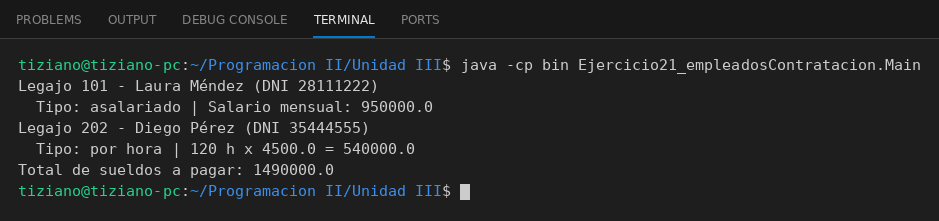

# Empleado

Programación II - Unidad 3 - Ejercicio 21

## Consigna
Modelar una jerarquía de clases con herencia: una clase base y subclases que reutilizan código con `super` y sobrescriben métodos. Empleados con distintos tipos de contratación.

## Lógica
- `Empleado` es la base (nombre, DNI, legajo) con `calcularSalario()` genérico.
- `EmpleadoAsalariado` devuelve el sueldo mensual; `EmpleadoPorHora` calcula tarifa por horas trabajadas.
- Ambas reescriben `mostrarInformacion()` llamando a `super`.
- `Main` calcula y suma los sueldos.

## Ejecución

